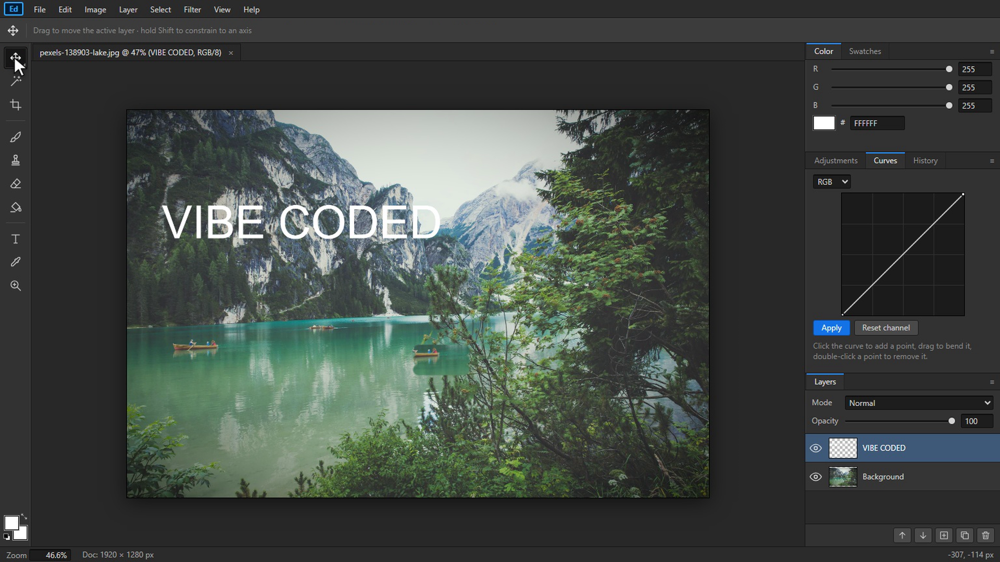

# Vibe-coded Photoshop (one HTML file)

A Photoshop-style image editor that runs in your browser, built **entirely by Claude Code** in a timed challenge for the Coding Tips video *"Everyone's Vibe Coding Adobe. Can I Build Photoshop in 10 Minutes?"*. I didn't write or edit a single line of it.

## Try it
Download `index.html` and open it in Chrome or Edge. No install, no server, no libraries. Everything runs locally in your browser; your images never leave your computer.

## How it was made (13 Oct 2026)
- Claude Code v2.1.296, **Sonnet 5.5**, medium effort, normal Claude Pro plan. Edits auto-accepted; the terminal (Bash) was switched off, so Claude could write files but never run or test the app itself.
- **Round 1** (`versions/round1.html`): one prompt, done at **9:38** on the clock, 1,654 lines. Scorecard **10/10**: open image, brush, eraser, layers, undo/redo, crop, brightness/contrast, blur & filters, text, export PNG.
- **Round 2** (`index.html`, overtime): a second prompt sent at 10:09, done at 14:38, 2,019 lines. Pro features **4/5**: magic wand ✓, clone stamp ✓, blend modes ✓, curves ✓, remove background ✗ (on a landscape it deletes the sky).

### Prompt 1
> Build me a Photoshop-style image editor that runs in the browser. One file, index.html, plain HTML/CSS/JavaScript, no libraries. It needs: open an image from my computer, a brush with colour and size, an eraser, layers (add, select, hide), undo and redo, a crop tool, brightness and contrast sliders, blur and a few other filters, a text tool, and export as PNG. Make it look as close to real Photoshop as you can: dark grey theme, a menu bar, an options bar, icon tools on the left, and Layers and Adjustments panels on the right.

### Prompt 2
> Great. Now make it more like real Photoshop: add a magic wand selection tool, a clone stamp tool, layer blend modes, a curves adjustment, and a one-click "remove background" button.

## Known bugs (kept as-is on purpose)
- The first new layer is called "Layer 2". There is no Layer 1.
- Remove Background only removes colours connected to the image border, so on a photo with a sky it removes the sky.
- Text becomes pixels once committed, and the Move tool ignores selections.

## Honest warning
This is vibe-coded software: nobody reviewed the code. It's a fun demo, not a tool to rely on.

## Credits
Screenshot photo: Markus Spiske on Pexels (pexels.com/photo/138903). Photoshop is a trademark of Adobe; this project isn't affiliated with Adobe or Anthropic.
